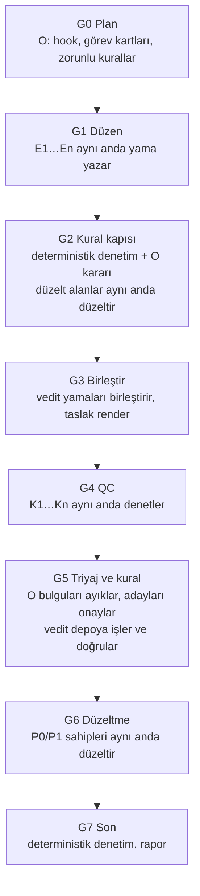

# AI Edit ve Ekip Kılavuzu

Bu kılavuz, Stüdyo'daki AI panelini ve `vedit ai-edit` komutunu anlatır: neyi kurman gerektiğini, nasıl kullanacağını ve arka planda sistemin nasıl çalıştığını. Kararların gerekçesi [ADR 0053](wiki/decisions/0053-seviyeli-ekip-orkestrator.md) içindedir.

## İçindekiler
1. [Sistem ne yapar](#1-sistem-ne-yapar)
2. [Kurulum](#2-kurulum)
3. [Hızlı başlangıç](#3-hızlı-başlangıç)
4. [AI paneli](#4-ai-paneli)
5. [Tek ajan mı, ekip mi](#5-tek-ajan-mı-ekip-mi)
6. [Ekip seviyeleri](#6-ekip-seviyeleri)
7. [Ekip nasıl çalışır](#7-ekip-nasıl-çalışır)
8. [Paralel çalışma](#8-paralel-çalışma)
9. [Kurallar nasıl güvenceye alınır](#9-kurallar-nasıl-güvenceye-alınır)
10. [Ayarlar](#10-ayarlar)
11. [Çıktılar, rapor ve geri alma](#11-çıktılar-rapor-ve-geri-alma)
12. [Bellek ve uzun koşular](#12-bellek-ve-uzun-koşular)
13. [Sorun giderme](#13-sorun-giderme)
14. [Komut özeti](#14-komut-özeti)

---

## 1. Sistem ne yapar

Bir projenin videosunu ve transkriptini alır, isteğine göre kurguyu (`work/edit/kurgu.json`) yapay zekâ ajanlarına yazdırır, sonucu doğrular ve bir taslak video render eder. İki çalışma biçimi vardır:

- **Tek ajan:** Bir ajan bütün kurguyu yazar. Hızlı ve ucuzdur.
- **Ekip:** Bir orkestratör işi editörlere böler. Editörler aynı anda çalışır, kalite kontrol ajanları taslağı denetler, bulunan kusurlar düzeltilir. Daha yavaş ve pahalıdır ama sonuç denetlenmiş olur.

Ajanlar dosyaya doğrudan yazmaz. Ekipte her editör yalnız bir JSON "yama" döndürür; yamaları `vedit` deterministik kurallarla birleştirir. Böylece iki ajan aynı klibe dokunamaz ve bozuk bir çıktı bütün kurguyu bozamaz.

## 2. Kurulum

### 2.1 Temel kurulum
Yalnız Windows 10/11. Ayrıntı [README](README.md#kurulum) içindedir; kısa hâli:

```
git clone https://github.com/Liberalmonkey/video-editor-public.git
cd video-editor
kur.bat
```

`kur.bat` Python ortamını (`.venv`), Stüdyo bağımlılıklarını ve HyperFrames'i kurar ve masaüstüne **Video Stüdyo** kısayolu koyar. Gerekenler: Python 3.11+, Node.js LTS, Git, FFmpeg, Edge ya da Chrome.

### 2.2 AI motorları
Ajanlar şu dört komut satırı aracından biriyle çalışır. En az birinin kurulu ve giriş yapılmış olması gerekir. Hazır ekip ön ayarı (`karisik`) Claude Code ile Antigravity'yi birlikte kullanır.

| Motor | Kurulum | Giriş | Ekipte varsayılan rol |
|---|---|---|---|
| Claude Code | [claude.com/claude-code](https://claude.com/claude-code) | terminalde bir kez `claude` | orkestratör (Opus), editörler (Sonnet) |
| Antigravity | PowerShell: `irm https://antigravity.google/cli/install.ps1 \| iex` | `agy` | kalite kontrol (Gemini), yedek motor |
| Codex | `npm i -g @openai/codex` | `codex login` | kullanılmaz (seçilebilir) |
| OpenCode | `npm i -g opencode-ai` | `opencode auth login` | kullanılmaz (seçilebilir) |

Stüdyo motorları kendisi tarar. AI panelinde motorun yanındaki nokta durumu gösterir: yeşil hazır, sarı uyarı (ör. model listesi boş, giriş yapılmamış), kırmızı kurulu değil. Kurulumdan sonra panelin sağ üstündeki yenile düğmesiyle yeniden tara.

> Antigravity masaüstü uygulamasının açık olması gerekmez; ekip yalnız `agy` komut satırı aracını kullanır.

### 2.3 Kurulumu doğrulama
```
.venv\Scripts\vedit kontrol
```
Testleri, arayüz tip denetimini, ajan dosyalarının kopyalarını ve wiki'yi denetler. Hepsi `TAMAM` olmalı.

## 3. Hızlı başlangıç

**Stüdyo'dan:**
1. `studio.vbs`'yi çift tıkla (ya da masaüstündeki Video Stüdyo kısayolu).
2. Projeyi aç. Girdi videosu `Projeler/inputs/<stüdyo>/<proje>/` altında olmalı.
3. Üst çubuktaki AI rozetine tıkla ya da AI panelini aç. **Edit** sekmesine geç.
4. İsteğini yaz, ör. "hızlı tempolu, sade grafik, sesi öne çıkar".
5. **Ekip**'i seç ve bir seviye seç; ilk deneme için **Low** önerilir.
6. **AI ile editle**'ye bas. İlerleme panelde görünür; bitince timeline yeni kurguyla yüklenir.

**Terminalden:**
```
.venv\Scripts\vedit ai-edit instagram/1 --ekip --seviye low --not "hızlı tempolu, sade grafik"
```

## 4. AI paneli

Panel iki sekmedir.

### 4.1 Edit sekmesi
Yukarıdan aşağıya:

| Alan | Ne yapar |
|---|---|
| İstek | Ajanlara giden serbest metin. Stil adı geçerse (ör. "ai-reels stiliyle") stil kendiliğinden seçilir. Ctrl+Enter başlatır. |
| Stil | Boşsa projenin seçili stili. Renk, font, hareket ve altyazı bu stilin token'ından gelir. |
| Motion | Grafik yoğunluğu: Yoğun, Orta, Az. |
| Kapsam | Yalnız tek ajanda: tüm video ya da timeline'da seçili klipler veya giriş-çıkış aralığı. Ekip her zaman bütün videoda çalışır. |
| Teslim et | Taslak temizse final render, ses ve denetim de yapılır. Ekipte açık P0 bulgu ya da denetim hatası varsa teslim atlanır; karar senin. |
| Tek ajan / Ekip | Çalışma biçimi. Seçim tarayıcıda hatırlanır. |
| Motor ve model | Tek ajanda görünür. |
| Seviye | Ekipte görünür: Low, Medium, High, XHigh, Max. Altında ekibin sayısı yazar. |
| Ekip ayarları | Katlanır bölüm: orkestratör, editör ve kalite kontrol motorları, slot ezmesi, eşzamanlılık, ön ayarlar (bkz. [10](#10-ayarlar)). |
| AI ile editle | Başlatır. Çalışırken yerini **Durdur** ya da **Hepsini durdur** alır. |

Ekip çalışırken altta ilerleme görünür:
- **Kapı adımları:** Plan, Düzen, Kural kapısı, Birleştir, QC, Triyaj ve kural, Düzeltme, Son. Gri bekliyor, turuncu çalışıyor, yeşil geçti, sarı kaldı. Kapının üstüne gelince notu görünür.
- **Özet satırı:** aşama, dağıtımı kimin yaptığı, açık P0/P1/P2 sayısı, kural sayıları.
- **Ajan kartları:** O, E1…En, K1…Kn. Her kartta rol, zaman aralığı, süre ve token yazar; sol kenar rengi durumu gösterir. Karta tıklayınca o ajanın canlı günlüğü açılır.

En altta **Son AI edit** satırı vardır: klip ve süre değişimi, **Geri al** ve **Rapor**.

### 4.2 Sohbet sekmesi
Serbest soru ya da tek bir düzeltme içindir ("şu altyazıyı büyüt" gibi). Motor, model ve mod seçilir:
- **Düzenle:** ajan dosya düzenleyebilir.
- **Yalnız plan:** ajan okur ve önerir, dosyaya dokunmaz.

Aynı sohbet sürer; "Yeni sohbet" sıfırlar. Motor değişince sohbet yeniden başlar.

## 5. Tek ajan mı, ekip mi

| Durum | Öneri |
|---|---|
| Küçük düzeltme, tek aralık | Tek ajan + Kapsam: seçim |
| Hızlı ilk taslak | Tek ajan |
| Yayına gidecek video, denetimli sonuç | Ekip, Low ya da Medium |
| Uzun video, yoğun grafik, çok bölüm | Ekip, High ve üstü |
| Kural deposunun sıkı uygulanması önemli | Ekip, XHigh ya da Max (kural denetçisi devreye girer) |

## 6. Ekip seviyeleri

Seviye yalnız ajan sayısını belirler. Her seviyede bunlara ek olarak tek bir **orkestratör** çalışır.

| Seviye | Editör | Kalite kontrol | Varsayılan editör dağılımı | Varsayılan kalite kontrol |
|---|---|---|---|---|
| Low | 2 | 1 | kurgu · {grafik, ses efekti, müzik, stil} | genel |
| Medium | 4 | 2 | kurgu · grafik ×2 · {ses efekti, müzik, stil} | kurgu+ses, görsel |
| High | 6 | 3 | kurgu · grafik ×3 · ses efekti · {müzik, stil} | kurgu, görsel, ses |
| XHigh | 8 | 4 | kurgu · grafik ×4 · ses efekti ×2 · {müzik, stil} | + kural |
| Max | 10 | 5 | kurgu · grafik ×5 · ses efekti ×2 · müzik · stil | + izleyici |

- "grafik ×3", grafiğin videonun üç zaman dilimine bölündüğü ve her dilimi ayrı bir editörün yaptığı anlamına gelir. Dilim sınırları konuşmadaki kelime aralarına düşer.
- Tablo yalnız varsayılandır. Orkestratör isteğine göre dağılımı değiştirir; ör. ses ağırlıklı istekte ses editörü sayısını artırır. Planı geçersizse sistem bu tabloya döner.

**Ölçüm** (`instagram/1`, Low, 2026-11-22): 629 sn, 9 ajan çağrısı, yaklaşık 1,30 M token, 4 P1 bulgu düzeltildi, 2 yeni kural işlendi. Seviye yükseldikçe süre aynı kalmaya yakın olur (editörler paralel çalışır), token ise editör ve kalite kontrol sayısıyla artar.

## 7. Ekip nasıl çalışır

### 7.1 Roller

| Rol | Kim | Ne yapar | Dosya yazar mı |
|---|---|---|---|
| Orkestratör (O) | `ekip-orkestrator` | İşi dağıtır, kartlara kural atar, kural kapısında karar verir, bulguları ayıklar, kural adaylarını onaylar | Hayır, yalnız JSON |
| Editör (E1…E10) | `editor-kurgu`, `editor-grafik`, `editor-ses-stil` | Görev kartındaki katmana ve aralığa yama yazar | Hayır, yalnız JSON yama |
| Kalite kontrol (K1…K5) | `kk-genel`, `kk-kurgu`, `kk-gorsel`, `kk-ses`, `kk-kural`, `kk-izleyici` | Taslağın karelerini ve ölçümünü açıp kanıtlı bulgu yazar | Hayır |
| vedit | kod | Birleştirir, denetler, render eder, kuralları depoya işler | Evet, tek yazan odur |

Rol tanımları `.claude/agents/` altındadır. Antigravity ve Codex kopyaları `python scripts/ajan_esitle.py` ile üretilir.

### 7.2 Katmanlar ve sahiplik
Kurgu beş katmana ayrılır. Her katmanın her zaman dilimi tam bir editöre aittir:

| Katman | İçerik | Bölünebilir mi |
|---|---|---|
| kurgu | V1 ve A1 izleri, kesim, sıra, hook, punch/zoom, geçiş, işaretler | Hayır, tek editör |
| grafik | V1 dışındaki görüntü izleri: motion, metin grafiği, sahne | Evet, zaman dilimlerine |
| ses efekti | A1 dışındaki ses izlerindeki efekt olayları | Evet |
| müzik | müzik izi, ducking, kazanç zarfı | Evet |
| stil | altyazı ayarı, motion teması | Hayır, tek editör |

Bir editör başka katmandaki bir klibe dokunursa yaması reddedilir. Kendi katmanına ama kendi aralığının dışına eklediği öğe ise tek başına düşer, yamanın gerisi birleşir. Grafik ve ses olayları konuşmadaki kelimeye çapalanır; kurgu editörü kesimi değiştirince `vedit` bu olayları yeni zamanlarına taşır.

### 7.3 Kapılar (G0–G7)
Akış sekiz kapıdan oluşur. Her kapı bir buluşma noktasıdır: içindeki paralel işler bitmeden sonraki kapı açılmaz.



| Kapı | Ne olur | Ne zaman "kaldı" olur |
|---|---|---|
| G0 Plan | Orkestratör hook'u seçer, işi görev kartlarına böler, her karta kural atar. `vedit` planı denetler: sayılar, tek kurgu sahibi, her katman ve zamanın tam bir editörde olması, QC'nin kurgu, görsel ve sesi kapsaması. | Hiç kalmaz. Plan geçersizse varsayılan dağıtıma düşer ve bunu not eder. |
| G1 Düzen | Bütün editörler aynı anda kendi yamasını yazar. | Bir editör yanıt vermediyse. O editör G2'de yeniden çağrılır. |
| G2 Kural kapısı | `vedit` her yamayı denetler: zorunlu kuralların `kural_uyum`'da olup olmadığı, deneme birleştirmesinde red ve düşen öğe, çakışmalar, kurgu denetimi. Sonra orkestratör her editöre "kabul" ya da "düzelt" der. Düzelt alanlar bir kez, aynı anda düzeltir. | Düzeltmeden sonra ihlal kalırsa; rapora yazılır. |
| G3 Birleştir | Yamalar birleşir (önce kurgu dışındakiler, sonra kurgu, sonra çapalar yeniden eşlenir), kurgu yazılır, taslak render edilir. | Bir yama reddedildiyse. |
| G4 QC | Kalite kontrol ajanları aynı anda, ortak kare ve ölçüm paketiyle denetler. | Hiç kalmaz. |
| G5 Triyaj ve kural | Orkestratör yanlış pozitifleri reddeder, kural adaylarını onaylar. `vedit` onaylı adayları kural deposuna yazar, depoyu yeniden okuyup her birinin orada olduğunu doğrular. | Bir aday depoda bulunamazsa; raporun başına uyarı düşer. |
| G6 Düzeltme | Yalnız P0/P1 bulgusu olan editörler, bu koşunun yeni kurallarıyla birlikte aynı anda düzeltir. Yalnız etkilenen aralıklar yeniden render edilir; kurgu değiştiyse taslağın tamamı. | Düzelten editör yeni kurallara uyduğunu yazmadıysa. |
| G7 Son | Deterministik denetim. P0 kaldıysa ya da `--tekrar-denetle` verildiyse ikinci QC paketi çıkarılır. | Denetim hatası kaldıysa. |

## 8. Paralel çalışma

Evet, ajanlar paralel çalışır. Kapıların içindeki işler aynı anda yürür, kapılar ise sırayla geçilir:

| Adım | Paralel mi |
|---|---|
| G1 editörler | Evet, hepsi aynı anda |
| G2 düzeltmeler | Evet, düzelt alan editörler aynı anda |
| G4 kalite kontroller | Evet, hepsi aynı anda |
| G6 düzeltmeler | Evet, bulgusu olan editörler aynı anda |
| Orkestratör çağrıları (G0, G2 kararı, G5) | Hayır; her biri öncekinin sonucuna bağlıdır |
| Render (G3, G6) | Tek iş; HyperFrames kendi içinde birden çok işçi kullanır |

Bu sıra bilinçlidir: kurallar ancak bütün yamalar geldikten sonra denetlenebilir, kalite kontrol ancak birleşmiş taslak üstünde çalışabilir. Seviye büyüdükçe editör sayısı artar ama G1 hâlâ tek bir adım sürer; bu yüzden süre seviyeyle pek uzamaz.

Gerçek koşudan örnek (`instagram/1`, Low, saniye):

```
plan/O     1549 → 1581
duzen/E1   1581 → 1645   ┐ aynı anda
duzen/E2   1581 → 1636   ┘
kapi/O     1645 → 1673
kapi/E2    1673 → 1715
qc/K1      1848 → 2047
triyaj/O   2047 → 2068
duzelt/E1  2068 → 2086   ┐ aynı anda
duzelt/E2  2068 → 2098   ┘
```

Aynı anda çalışan ajan sayısı **Eşzamanlı ajan** ayarıdır. Boş bırakılırsa editör sayısına eşittir. Bilgisayar zorlanıyorsa ya da motorun hız sınırı varsa düşür.

## 9. Kurallar nasıl güvenceye alınır

Kurallar `library/kurallar/kurallar.json` deposundadır. Her kural tek satırlık bir `YAP:` ya da `YAPMA:` emridir. `library/checks.md` bu depodan üretilir, elle yazılmaz.

Ekip kuralları üç noktada güvenceye alır:

1. **Atama (G0).** Her görev kartı zorunlu kurallar taşır: kartın katmanına uyan bütün etkin P0 kurallar (`vedit` bunları her zaman ekler) ve orkestratörün seçtiği P1'ler.
2. **Uyum kapısı (G2).** Editör, zorunlu kuralların her biri için yamasındaki `kural_uyum` alanına nasıl uyduğunu yazmak zorundadır. Eksik uyum ya da reddedilen yama, orkestratör "kabul" dese bile düzeltmeye geri gider.
3. **Kural işleme (G5).** Kalite kontrol, tekrar edebilecek bir kusur gördüğünde `kural_adayi` yazar. Orkestratör adayı onaylarsa `vedit` adayı depoya ekler, depoyu yeniden okur ve kuralın orada olduğunu doğrular. Kullanıcının daha önce sildiği bir kuralın benzeri yeniden eklenmez. Yeni kurallar G6'da düzelten editörlere zorunlu kural olarak gider.

Kalite kontrolün kural ihlali bulgusu (`kural_id`) o kuralın tekrar sayacını artırır. İki kez ihlal edilen ölçülebilir kural, koda kapı olarak yazılması için önerilir (ADR 0041).

**Kuralları yönetmek:**
- Stüdyo > Kurallar sekmesi.
- `vedit kural ekle "YAPMA: ikonu altyazı bandının üstüne koyma."`
- Yeni kuralın önce senin onayını beklemesini istiyorsan `library/kurallar/ayar.json` içinde `"onay_bekle": true` yap. Bu durumda yeni kurallar "öneri" olarak girer.

## 10. Ayarlar

### 10.1 Ekip ayarları bölümü
- **Orkestratör / Editörler / Kalite kontrol:** her grup için motor, model, effort (akıl yürütme seviyesi) ve yedek motor. Bir ajan iki kez başarısız olursa yedek motora geçer.
- **Slot bazında ez:** tek bir slota ayrı motor ver, ör. yalnız E1 için Opus.
- **Eşzamanlı ajan:** aynı anda çalışacak en çok ajan, 1–15. Boş bırakılırsa otomatik.
- **Ön ayar:** seç, kaydet, varsayılan yap ya da yalnız bu projeye kaydet (**Projeye**).

> "Seviye" ekibin büyüklüğüdür (Low…Max). "effort" ise tek bir ajanın düşünme derinliğidir. İkisi ayrı ayarlardır.

### 10.2 Ayar dosyaları ve öncelik
Sonraki öncekini ezer:
1. `library/ekip.json`: ön ayarlar ve varsayılanı (hazır: `karisik`, `yalniz-claude`).
2. `work/edit/ekip.json`: yalnız bu proje.
3. `--ekip-dosyasi <dosya>`: Stüdyo her başlatmada `work/edit/ekip/istek-ayar.json` yazar.
4. Komut satırı bayrakları (`--seviye`, `--motion`, `--stil`).

Örnek ön ayar:
```json
{
 "ad": "karisik",
 "ekip_seviye": "medium",
 "gruplar": {
  "orkestrator": {"motor": "claude", "model": "claude-opus-5-5", "seviye": "high", "yedek_motor": "antigravity", "yedek_model": "gemini-4-argon-high"},
  "editor": {"motor": "claude", "model": "claude-sonnet-5-5", "seviye": "medium", "yedek_motor": "antigravity", "yedek_model": "gemini-4-neon-high"},
  "kk": {"motor": "antigravity", "model": "gemini-4-argon-high", "yedek_motor": "claude", "yedek_model": "claude-sonnet-5-5"}
 },
 "ezme": {"E1": {"motor": "claude", "model": "claude-opus-5-5", "seviye": "high"}},
 "eszamanlilik": null,
 "motion": "yogun",
 "stil": null
}
```
Burada `gruplar` içindeki `seviye` alanı effort'tur. Eski 6 slotlu ayar dosyaları okunurken kendiliğinden bu biçime çevrilir.

## 11. Çıktılar, rapor ve geri alma

Her koşu `Projeler/outputs/<stüdyo>/<proje>/work/edit/` altına yazar:

| Dosya | İçerik |
|---|---|
| `kurgu.json` | Yeni kurgu (tek kaynak) |
| `ai-edit.rapor.md` | Okunur rapor: seviye, dağıtım, görev kartları, kapılar, kurallar, ajan başına süre ve token |
| `ekip/durum.json` | Canlı durum; Stüdyo bunu okur |
| `ekip/plan.json`, `ekip/sozlesme.json` | Orkestratörün planı, editörlere giden sözleşme (kesim, kelime dizinleri, stil) |
| `ekip/<kapı>/<slot>.istem.md` | Ajana giden istem (`plan`, `duzen`, `kapi`, `qc`, `triyaj`, `duzelt`) |
| `ekip/<kapı>/<slot>.cikti.txt` | Ajanın okunur günlüğü |
| `ekip/<kapı>/<slot>.meta.json` | Motor, model, süre, token |
| `ekip/qc/` | Kalite kontrolün kareleri, kontak sayfası, ölçüm |
| `ekip/ozet.json` | Makine okunur özet |
| `renders/taslak.mp4` | Taslak video |

**Geri alma:** Stüdyo > AI > Edit > Son AI edit > **Geri al**. Bu, kurguyu editten önceki sürüme döndürür; şimdiki sürüm `kurgu-gecmis/` altında kalır. Stüdyo'da sen kurguyu değiştirirken ekip yazmaya çalışırsa senin değişikliğin ezilmez.

## 12. Bellek ve uzun koşular

Ekip birkaç dakikadan uzun sürer ve G3'te bellek kullanımı tepe yapar: ajanlar bellekteyken HyperFrames taslak render'ı için birden çok Chrome açar.

- **Koşuyu Stüdyo'dan ya da ayrı bir terminalden başlat.** Claude Code'un arka plan kabuğunda başlatılan iş, makinenin belleği azalınca Claude Code tarafından durdurulabilir.
- **Render işçisi belleğe göre seçilir.** Boş RAM 3 GB'ın altındaysa 1, 6 GB'ın altındaysa 2 işçi açılır; üstündeyse HyperFrames otomatik (4) seçer. Elle sabitlemek için `VEDIT_HF_ISCI=2` ortam değişkenini ver. Render satırı seçilen işçiyi ve boş belleği yazar.
- 16 GB'lık bir makinede koşu sırasında ağır uygulamaları kapatmak (fazla tarayıcı sekmeleri, masaüstü sohbet uygulamaları, Antigravity masaüstü uygulaması) render'ı hızlandırır.

## 13. Sorun giderme

| Belirti | Neden | Çözüm |
|---|---|---|
| "AI ile editle" soluk, altında "Kurulu olmayan motor: …" | Seçili gruplardan birinin motoru kurulu değil ya da giriş yapılmamış | Motoru kur ve giriş yap, yenile; ya da Ekip ayarlarında o grubu başka motora al |
| Kart kırmızı (hata) | Ajan iki denemede de yanıt vermedi, yedek motor da olmadı | Karta tıklayıp günlüğe bak; motor girişini ya da kotayı denetle |
| Kart sarı (yedekte) | Ana motor başarısız oldu, yedek motor çalışıyor | İş sürer; kalıcıysa ana motoru düzelt |
| Raporda "varsayılan dağıtım" | Orkestratörün planı geçersizdi (ör. kurguyu iki editöre verdi) | Sorun değil, sabit tabloyla devam edildi; neden raporda yazar |
| G2 "kaldı" | Düzeltmeden sonra da kural uyumu eksik ya da yama reddedildi | Raporun "Kural kapısında kalan ihlal" bölümüne bak |
| G5 "kaldı", raporun başında uyarı | Onaylanan bir kural adayı depoya işlenemedi | `library/kurallar/kurallar.json` yazılabilir mi bak, Stüdyo > Kurallar'ı aç |
| Koşu yarıda kesildi, kurgu yarım | İş durduruldu ya da bellek bitti | Geri al ile önceki sürüme dön ve yeniden başlat |
| Teslim yapılmadı | Açık P0 bulgu ya da denetim hatası var | Raporu oku; düzelt ya da teslim kararını sen ver |
| Kart günlüğü boş | Ajan henüz yazmadı | Birkaç saniye bekle; günlük 2 sn'de bir yenilenir |

## 14. Komut özeti

```
# Ekip
.venv\Scripts\vedit ai-edit <stüdyo>/<proje> --ekip
.venv\Scripts\vedit ai-edit <stüdyo>/<proje> --ekip --seviye high --not "istek metni"
.venv\Scripts\vedit ai-edit <stüdyo>/<proje> --ekip --seviye medium --stil ai-reels --motion orta
.venv\Scripts\vedit ai-edit <stüdyo>/<proje> --ekip --tekrar-denetle      # düzeltmeden sonra ikinci QC paketi
.venv\Scripts\vedit ai-edit <stüdyo>/<proje> --ekip --final               # temizse teslim et
.venv\Scripts\vedit ai-edit <stüdyo>/<proje> --ekip --sifirdan            # mevcut kurguyu geçmişe bırakıp sıfırdan kur
.venv\Scripts\vedit ai-edit <stüdyo>/<proje> --ekip --ekip-dosyasi ayar.json

# Tek ajan
.venv\Scripts\vedit ai-edit <stüdyo>/<proje> --motor claude --model claude-sonnet-5-5 --not "istek"
.venv\Scripts\vedit ai-edit <stüdyo>/<proje> --aralik 12.0 18.5 --not "bu aralıkta tempoyu artır"

# Kurallar
.venv\Scripts\vedit kural ekle "YAP: ..."

# Stüdyo ve denetim
studio.vbs                     # ya da: .venv\Scripts\vedit studio
.venv\Scripts\vedit kontrol    # bütün denetimler
python scripts\ajan_esitle.py  # rol dosyası değişince ajan kopyalarını üret
```
